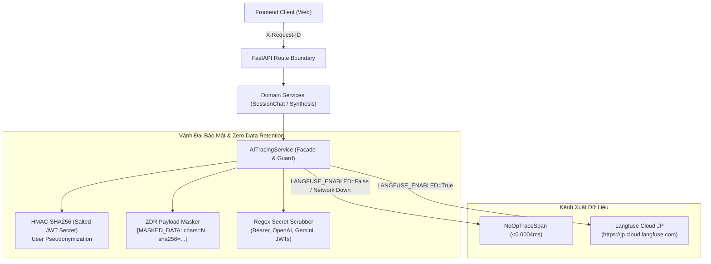

# HƯỚNG DẪN AI OBSERVABILITY & TRACING VỚI LANGFUSE

> **Dự án:** VeriScholar — Academic Research & Writing Assistant  
> **Phân hệ:** Hệ thống Quan sát, Đánh giá & Giám sát Luồng AI (Langfuse AI Tracing)  
> **Phiên bản:** 1.0.0 (Tương thích Langfuse v4 / Cloud JP)  
> **Cập nhật:** 2026-10-15  

---

## 1. TỔNG QUAN KIẾN TRÚC & NGUYÊN TẮC THIẾT KẾ

Hệ thống quan sát AI của VeriScholar được xây dựng nhằm theo dõi, gỡ lỗi và đánh giá chất lượng toàn bộ các luồng AI (Socratic Chat Streaming, Note Synthesis, Document Summarization) mà **không làm suy giảm quyền riêng tư của học giả và không làm đứt gãy luồng nghiệp vụ khi dịch vụ quan sát gặp sự cố**.



### Các Nguyên Tắc Bất Biến (Architectural Invariants)
1. **Fail-Safe & No-Op Facade:** Tracing là tiện ích quan sát, không phải điều kiện tiên quyết. Nếu thiếu API keys, mạng chập chờn hoặc Langfuse trả lỗi, toàn bộ ngoại lệ được bọc an toàn (`safe error absorption`), chuyển sang `NoOpTraceSpan` (<0.0004ms). **Nghiệp vụ nghiên cứu của học giả tuyệt đối không bao giờ bị dừng hay báo lỗi do tracing.**
2. **Zero Data Retention (ZDR) & Privacy-First:**
   - **User ID:** Không bao giờ gửi UUID người dùng dạng thô. Tất cả định danh đều được băm bằng thuật toán `HMAC-SHA256` với salt bảo mật từ `JWT_SECRET_KEY`.
   - **Nội dung bản thảo & PDF:** Khi bật `LANGFUSE_MASK_INPUT_OUTPUT=True` (mặc định), nội dung prompt, chunks và câu trả lời hoàn chỉnh được thay thế bằng chuỗi tóm tắt độ dài và fingerprint: `[MASKED_DATA: chars=N, sha256=abcdef12]`.
   - **Secret Scrubber:** Tự động quét và loại bỏ Bearer tokens, OpenAI keys (`sk-...`), Gemini keys (`AIzaSy...`), GitHub tokens và JWTs khỏi mọi error logs trước khi đẩy lên đám mây.
3. **Correlation Xuyên Suốt:** Mọi trace được liên kết chặt chẽ qua:
   - `traceId`: Định danh duy nhất cho một chu trình tương tác.
   - `sessionId`: Định danh phiên nghiên cứu đa tài liệu (`SessionModel.id`).
   - `userId`: Định danh học giả đã giả danh hóa.
   - `tags`: Nhãn phân loại (`chat_stream`, `note_synthesis`, `document_summary`, `module1`).

---

## 2. CẤU HÌNH HỆ THỐNG (.ENV)

Tất cả cấu hình được quản lý qua `pydantic-settings` tại [`apps/api/src/api/core/config.py`](file:///home/VeriScholar/Workspace/VeriScholar/apps/api/src/api/core/config.py). Cấu hình mẫu an toàn (không chứa secret) nằm tại [`.env.example`](file:///home/VeriScholar/Workspace/VeriScholar/.env.example):

```bash
# ==============================================================================
# Langfuse AI Observability Configuration
# ==============================================================================
# Khóa định danh dự án từ Langfuse Cloud (Settings -> API Keys)
LANGFUSE_PUBLIC_KEY=pk-lf-...
LANGFUSE_SECRET_KEY=sk-lf-...

# Endpoint chính thức của dự án (Khu vực Tokyo, Nhật Bản)
LANGFUSE_BASE_URL=https://jp.cloud.langfuse.com
LANGFUSE_HOST=https://jp.cloud.langfuse.com

# Trạng thái kích hoạt (Tự động kích hoạt khi có đủ cặp khóa PUBLIC/SECRET)
LANGFUSE_ENABLED=true

# Tỷ lệ lấy mẫu (1.0 = 100% traces; 0.1 = 10% traces)
LANGFUSE_SAMPLE_RATE=1.0

# Bảo vệ Zero Data Retention (true: che giấu nội dung văn bản bản thảo)
LANGFUSE_MASK_INPUT_OUTPUT=true

# Môi trường báo cáo (development | staging | production)
LANGFUSE_ENVIRONMENT=development
```

> [!IMPORTANT]
> **Tuyệt đối không đưa `LANGFUSE_SECRET_KEY` ra frontend:**  
> File `apps/web/.env` chỉ chứa các biến `VITE_*`. Khóa bí mật chỉ được lưu trên máy chủ backend (`apps/api/.env`).

---

## 3. CẤU TRÚC PHÂN CẤP SPANS (MODULE 1 TRACE HIERARCHY)

Trong một request hỏi-đáp Socratic ([`POST /api/v1/sessions/{id}/messages`](file:///home/VeriScholar/Workspace/VeriScholar/apps/api/src/api/v1/router.py)), trace được tạo thành cây phân cấp như sau:

```text
Trace: session_chat_stream (Root)
 ├── Span: guardrail_check       (Kiểm tra prompt injection, jailbreak)
 ├── Span: retrieval             (Tìm kiếm Hybrid Retrieval trong pgvector)
 ├── Span: reranking             (Xếp hạng độ liên quan, lọc relevance cutoff >= 0.35)
 ├── Span: context_assembly      (Đóng gói XML namespacing đa tài liệu, phân loại ý định)
 └── Generation: llm_generation  (Streaming tokens, CoT reasoning, ghi nhận token usage)
```

### Các thông số thu thập (Metrics)
- **Latency (Độ trễ):** Đo lường chi tiết cho từng chặng (Retrieval SLA < 500ms, TTFT < 1.2s, Generation SLA < 5s).
- **Token Usage:** `prompt_tokens`, `completion_tokens`, `total_tokens`.
- **Metadata:** Tên model (`gpt-5.6-luna`, `ai/smollm2`), intent học thuật, số lượng tài liệu tham chiếu.

---

## 4. BỘ CÔNG CỤ DÀNH CHO KỸ SƯ & AI AGENTS

Để phục vụ quản trị, kiểm thử và theo dõi trace, dự án cung cấp 3 kênh tiếp cận:

### 4.1. Agent Skill (`langfuse`)
Được cài đặt trực tiếp vào monorepo tại [`.agents/skills/langfuse/SKILL.md`](file:///home/VeriScholar/Workspace/VeriScholar/.agents/skills/langfuse/SKILL.md).
- Tất cả các agent/worker có thể đọc trực tiếp hướng dẫn và tài liệu chính thức từ thư mục này.
- Được kích hoạt tự động khi thực hiện các tác vụ liên quan đến observability, prompt management, hoặc evals.

### 4.2. Langfuse CLI (`langfuse-cli`)
Công cụ dòng lệnh chính để truy vấn dữ liệu từ Langfuse mà không cần mở trình duyệt:

```bash
# Kiểm tra phiên bản CLI
npx langfuse-cli --version

# Truy vấn danh sách traces/observations an toàn từ file .env (không in key ra terminal)
npx langfuse-cli api observations list --env .env --host https://jp.cloud.langfuse.com --limit 10

# Kiểm tra danh sách prompts hiện có trên hệ thống
npx langfuse-cli api prompts list --env .env --host https://jp.cloud.langfuse.com
```

### 4.3. Model Context Protocol (MCP)
- **Endpoint từ xa:** `https://jp.cloud.langfuse.com/api/public/mcp`
- **Trạng thái:** Antigravity hỗ trợ cấu hình MCP toàn cục qua `~/.gemini/config/mcp_config.json`. Việc nạp MCP mới vào phiên làm việc trực tiếp yêu cầu khởi động lại Language Server/Session. Do đó, **Agent Skill và CLI là kênh thực thi chính**, bảo đảm không làm gián đoạn các worker đang chạy.

---

## 5. XỬ LÝ SỰ CỐ & TROUBLESHOOTING

| Hiện tượng | Nguyên nhân khả dĩ | Giải pháp khắc phục |
| :--- | :--- | :--- |
| **Log ghi `ai_tracing_disabled_noop_mode`** | `LANGFUSE_ENABLED=False` hoặc chưa cấu hình keys. | Thêm `LANGFUSE_PUBLIC_KEY` và `LANGFUSE_SECRET_KEY` vào file `.env`. |
| **Lỗi `Invalid URL` khi gọi CLI** | Thiếu `--host` hoặc file `.env` chứa `HOST=0.0.0.0` của server. | Luôn truyền cờ rõ ràng: `--host https://jp.cloud.langfuse.com` khi gọi CLI. |
| **Không thấy trace mới trên giao diện Langfuse** | Traces chưa được flush trước khi tiến trình kết thúc. | Đảm bảo gọi `service.flush()` hoặc để tiến trình nền tự động flush trước khi shutdown. |
| **Nghi ngờ lộ nội dung nhạy cảm** | `LANGFUSE_MASK_INPUT_OUTPUT` bị đặt thành `False`. | Đặt `LANGFUSE_MASK_INPUT_OUTPUT=True` trong file `.env` để bảo đảm Zero Data Retention. |
