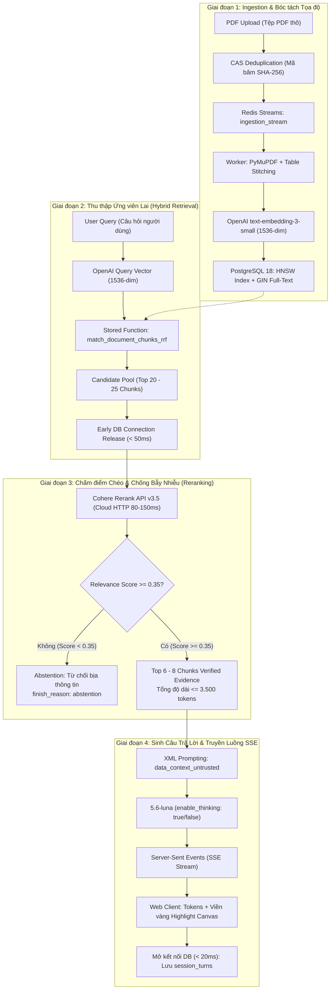
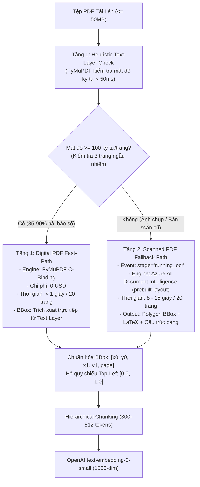

# Lựa Chọn Công Nghệ Backend & Đánh Đổi Kỹ Thuật (Module 1 - Deep Read)

Tài liệu này tổng hợp các quyết định lựa chọn công nghệ cốt lõi, đánh đổi kỹ thuật (Engineering Trade-offs) và thiết kế **Đường ống Dữ liệu Advanced RAG Toàn diện (End-to-End Advanced RAG Pipeline)** cho **Module 1: Đọc Sâu & Đối Thoại Kép Bài Báo Học Thuật** của nền tảng **VeriScholar** dựa trên [PRD.md](file:///home/dammanhdungvn/Downloads/Workspace/VeriScholar/docs/vi/PRD.md), [design-architecture.md](file:///home/dammanhdungvn/Downloads/Workspace/VeriScholar/docs/vi/design-architecture.md) và [design-database.md](file:///home/dammanhdungvn/Downloads/Workspace/VeriScholar/docs/vi/design-database.md).

---

## 0. BẢNG THUẬT NGỮ CÔNG NGHỆ DÀNH CHO KỸ SƯ MỚI (FRESHER GLOSSARY)

| Thuật ngữ | Khái niệm tiếng Anh | Giải thích trực quan cho Fresher |
| :--- | :--- | :--- |
| **Advanced RAG** | Advanced Retrieval-Augmented Generation | Kỹ thuật tìm kiếm tăng cường nâng cao: Kết hợp tìm kiếm vector đa chiều, tìm kiếm từ khóa và chấm điểm chéo (Reranking) để AI trả lời chính xác, dẫn nguồn đúng trang tài liệu. |
| **Bounding Box** | Bounding Box Coordinate `[x0, y0, x1, y1, page]` | Khung chữ nhật bao quanh đoạn văn bản hoặc hình ảnh trên trang PDF; frontend dùng tọa độ này để vẽ khung viền vàng highlight nổi bật cho người dùng xem. |
| **Dense Vector** | Dense Vector Embedding | Mảng gồm 1536 con số thực biểu diễn ý nghĩa ngữ cảnh sâu sắc của một đoạn văn bản (mô hình OpenAI `text-embedding-3-small` biến từ ngữ thành các con số trong không gian 1536 chiều bản địa). |
| **Sparse / Lexical Search** | Full-Text Search (`tsvector`) | Tìm kiếm từ khóa chính xác: So khớp từng chữ cái, số hiệu, mã công thức toán học hoặc tên riêng mà không làm thay đổi từ. |
| **HNSW** | Hierarchical Navigable Small World | Chỉ mục đồ thị đa tầng thông minh trên PostgreSQL; cho phép tìm kiếm các vector có ý nghĩa gần nhau nhất chỉ trong vài phần nghìn giây thay vì phải so sánh toàn bộ cơ sở dữ liệu. |
| **Cosine Distance (`<=>`)** | Cosine Distance Metric | Phép đo góc hình học giữa 2 vector: Góc càng nhỏ (khoảng cách càng gần 0) thì nghĩa của 2 câu văn càng tương đồng. |
| **RRF** | Reciprocal Rank Fusion | Công thức toán học kết hợp điểm số của tìm kiếm ngữ nghĩa và tìm kiếm từ khóa để tạo ra danh sách tài liệu gợi ý công bằng và chuẩn xác nhất. |
| **Cross-Encoder Reranker** | Cross-Encoder Reranker (Cohere API) | Dịch vụ AI đám mây chuyên dụng (Cohere Rerank v3.5) nhận vào cả câu hỏi và danh sách đoạn trích cùng lúc để chấm điểm xác suất tương quan thực tế (từ 0.0 đến 1.0) trong 80 - 150ms, giúp lọc bỏ hoàn toàn các đoạn gây nhiễu mà không tốn tài nguyên GPU máy chủ. |
| **Thinking Mode Toggle** | Reasoning / Thinking Capability (`enable_thinking`) | Công tắc điều khiển suy luận sâu trên mô hình `5.6-luna`: Bật (`true`) khi cần phản biện khoa học, giải thích cơ chế phức tạp; Tắt (`false`) cho hỏi đáp nhanh nhằm tối ưu hóa thời gian phản hồi (TTFT). |
| **Table Stitching** | Cross-Page Table Stitching | Kỹ thuật ghép nối bảng biểu vắt ngang nhiều trang PDF bằng thuật toán nhận diện tiêu đề cột (header) ở trang trước để nối liền các dòng dữ liệu ở trang tiếp theo. |
| **CAS Deduplication** | Content-Addressed Storage Deduplication | Cơ chế khử trùng lặp tệp thông qua mã băm nội dung SHA-256 (`content_hash`): nếu 2 người dùng tải lên cùng 1 bài báo, hệ thống chỉ lưu và bóc tách đúng 1 lần duy nhất để tiết kiệm dung lượng và chi phí embedding. |
| **Early Connection Release** | Early DB Connection Release Pattern | Mẫu thiết kế giải phóng kết nối cơ sở dữ liệu ngay lập tức sau khi truy vấn xong dữ liệu (dưới 50ms) trước khi mở luồng Server-Sent Events (SSE) kéo dài hàng chục giây, chống cạn kiệt Connection Pool của PostgreSQL. |
| **`5.6-luna` (OpenAI Compatible)** | Frontier Reasoning LLM | Mô hình AI đám mây chủ lực tương thích chuẩn OpenAI API, hỗ trợ cơ chế suy luận chuyên sâu (Thinking Mode), tuân thủ định dạng JSON nghiêm ngặt và trích dẫn tọa độ trực quan. |
| **Grounded Generation** | Hallucination-Free Generation | Sinh văn bản có căn cứ: Mọi câu trả lời của AI bắt buộc phải dựa trên bằng chứng có trong bài báo; nếu không có bằng chứng, AI phải từ chối trả lời (Abstention) thay vì tự bịa ra thông tin. |

---

## 1. BẢNG MA TRẬN LỰA CHỌN CÔNG NGHỆ & ĐÁNH ĐỔI KỸ THUẬT (PRODUCTION-READY)

| Tầng chức năng | Công nghệ lựa chọn | Vai trò trong hệ thống Advanced RAG | Đánh đổi & Quyết định kỹ thuật |
| --- | --- | --- | --- |
| **Document Ingestion** *(Bóc tách tài liệu)* | **Two-Tier Ingestion Gate: PyMuPDF (`fitz`)** (Fast-Path 90% Digital PDF) + **Azure AI Document Intelligence (`prebuilt-layout`)** (Fallback cho Scanned PDF) | Bóc tách khối văn bản (text blocks), cấu trúc 2 cột, bảng biểu vắt trang và trích xuất tọa độ hình học chuẩn hóa `[x0, y0, x1, y1, page]`. | **Tầng 1 (Digital Fast-Path):** PyMuPDF kiểm tra mật độ ký tự < 50ms; nếu đạt >= 100 ký tự/trang -> trích xuất trực tiếp Text Layer (< 1 giây / 20 trang, 0 USD). **Tầng 2 (Scanned Fallback):** Nếu mật độ < 100 ký tự/trang (ảnh chụp, tài liệu scan cũ) -> gọi Azure Document Intelligence (8 - 15 giây / 20 trang) bóc tách công thức LaTeX, bảng biểu và polygon BBox chính xác. 0% GPU. |
| **Relational & Vector DB** *(CSDL quan hệ & vector)* | **PostgreSQL 18** + **`pgvector 0.8.6`** | Lưu siêu dữ liệu bài báo (Metadata), các đoạn văn bản (Chunks) và vector nhúng 1536 chiều (`HNSW vector_cosine_ops`). | Hợp nhất dữ liệu quan hệ, dữ liệu JSONB và vector trong 1 CSDL duy nhất hỗ trợ giao dịch ACID; loại bỏ hoàn toàn rủi ro lệch dữ liệu phân tán. Cấu hình `ef_search = 100` và `iterative_scan = 'relaxed'`. Đã chuẩn hóa trên toàn bộ hệ thống (`docker-compose.yml`, tài liệu DDL). |
| **Lexical Search** *(Tìm kiếm từ khóa)* | **PostgreSQL Full-Text Search (`tsvector 'simple'`)** | Tìm kiếm từ khóa chính xác nguyên bản (ký hiệu toán học, thuật ngữ khoa học, mã hóa chất, tên riêng). | Sử dụng từ điển `'simple'` để hỗ trợ tìm kiếm đa ngữ Anh - Việt, thực thi Hybrid Search kết hợp RRF ngay trong một câu lệnh SQL nội bộ mà không cần vận hành thêm cụm Elasticsearch / OpenSearch cồng kềnh. |
| **Embedding Model** *(Mô hình tạo vector)* | **OpenAI `text-embedding-3-small`** (1536 chiều) | Nhúng đoạn văn bản (Chunks) và câu hỏi (Query) thành dense vector trong không gian ngữ nghĩa 1536 chiều bản địa. | 0% GPU cục bộ. Chi phí siêu rẻ (~ 0.02 USD / 1 triệu tokens, chỉ tốn khoảng 0.0003 USD cho bài báo 20 trang). Giữ nguyên vẹn 1536 chiều gốc để tối ưu hóa độ chính xác ngữ nghĩa và tương thích tuyệt đối với chỉ mục HNSW trên `pgvector`. |
| **Reranking Engine** *(Chấm điểm tương quan chéo)* *(Mắt xích trọng yếu)* | **Cohere Rerank API (`rerank-v3.5`)** | Chấm điểm tương đồng chéo (Cross-Encoder) giữa Query và Top 20 - 25 chunks ứng viên từ Hybrid RRF qua HTTP POST. | **Mắt xích sống còn:** Cung cấp điểm số xác suất tương quan thực tế (Relevance Score từ 0.0 đến 1.0) trong 80 - 150ms. Áp dụng **Ngưỡng cắt >= 0.35**, loại trừ triệt để hiện tượng phân tâm (*The Distracting Effect*) và kích hoạt cơ chế từ chối trả lời (*Abstention Prompting*) khi không tìm thấy bằng chứng. 0% GPU / CPU overhead. |
| **LLM Gateway** *(Cổng mô hình AI)* | **`5.6-luna` (OpenAI-compatible)** + **Thinking Mode Toggle** | Sinh câu trả lời có căn cứ xác thực (Grounded Generation) kèm mã trích dẫn tọa độ trực quan và phân tích tài liệu chuyên sâu. | Tương thích hoàn toàn chuẩn OpenAI API qua AsyncOpenAI client. Hỗ trợ cờ điều khiển suy luận sâu **`enable_thinking: bool`**: Bật khi cần giải thích đa bài báo, phản biện khoa học, kiểm chứng công thức; Tắt khi cần hỏi đáp nhanh nhằm tối ưu TTFT. 0% GPU cục bộ. |
| **Task Queue & Workers** *(Hàng đợi tác vụ ngầm)* | **Redis Streams / ARQ Worker** | Hàng đợi tác vụ xử lý tài liệu bất đồng bộ bền vững (Durable Task Queue). | Chống trôi dạt hoặc mất tác vụ (Task Evaporation) khi bóc tách các tệp PDF lớn (lên tới 50MB); hỗ trợ xác nhận hoàn thành tường minh (Explicit ACK), Consumer Groups và hàng đợi thư chết (DLQ). |
| **Backend Framework** *(Nền tảng máy chủ)* | **FastAPI** + **Python 3.12** + **`uv`** | Cung cấp REST API chuẩn Google AIP-136 và dòng dữ liệu Server-Sent Events (SSE) để truyền chữ thời gian thực. | Hỗ trợ xử lý bất đồng bộ (asyncio) hiệu năng cao; áp dụng cơ chế *Early Connection Release* (giải phóng kết nối DB trước khi mở luồng stream SSE) nhằm không làm cạn kiệt connection pool. |
| **Frontend & UI** *(Giao diện người dùng)* | **React 19 (TSX)** + **Vite** + **PDF.js** | Hiển thị tài liệu PDF gốc đa tab và vẽ khung chữ nhật highlight trực quan lên Canvas. | Cơ chế *Dynamic Viewport Matrix Scaling* kết hợp `page_dimensions` và `rotation_deg`, đảm bảo khung highlight viền vàng không bị lệch trên mọi kích thước màn hình và góc xoay trang. |
| **Local Infrastructure** *(Hạ tầng cục bộ)* | **Docker Compose** | Đóng gói PostgreSQL 18 (`pgvector`) và Redis 7. | Tối giản hóa hạ tầng cục bộ: Không cần cấu hình GPU, CUDA hay Docker Model Runner. Chỉ cần một câu lệnh duy nhất (`docker compose up -d`) là sẵn sàng toàn bộ môi trường lưu trữ và hàng đợi. |

---

## 2. TẠI SAO LOẠI BỎ CÁC FRAMEWORK AGENT TRUNG GIAN (LANGCHAIN / AUTOGEN / CREWAI)?

Dưới lăng kính của *AI Engineering* (Chip Huyen) và *Hands-On RAG for Production* (Ofer Mendelevitch & Forrest Sheng Bao), hệ thống **VeriScholar chủ động loại bỏ hoàn toàn các framework agent trung gian cồng kềnh** (như LangChain, LlamaIndex, AutoGen hay CrewAI) để tự xây dựng trực tiếp thông qua **SDK chính thức (Official OpenAI SDK)**, `httpx` (gọi Cohere Rerank API) và kiến trúc lục giác thuần túy (Ports & Adapters).

Quyết định kỹ thuật này mang lại 4 lợi ích cốt tử cho môi trường sản xuất:

1. **Kiểm soát tuyệt đối Hợp đồng Tọa độ (Spatial Invariants):**
   - Các thư viện ngoài thường coi văn bản là chuỗi trần (`str`) kèm theo siêu dữ liệu lỏng lẻo (`dict`).
   - VeriScholar yêu cầu các ràng buộc hình học bất biến nghiêm ngặt: mảng 2 chiều không-null `[[x0, y0, x1, y1, page], ...]`, ma trận kích thước trang `[width_pt, height_pt]` và góc xoay `rotation_deg`. Tự viết adapter đảm bảo dữ liệu tọa độ không bị cắt xén, trôi lệch hay phân tích sai định dạng.

2. **Phòng thủ Prompt Injection & Thứ bậc Chỉ thị (Instruction Hierarchy):**
   - Các framework agent thường tự ý chèn prompt ẩn, memory wrapper hoặc chuỗi suy luận nội bộ khó kiểm soát và dễ bị khai thác qua bẫy dữ liệu học thuật.
   - Tự đóng gói prompt giúp hệ thống cô lập an toàn dữ liệu bài báo chưa tin cậy trong các thẻ XML phân tách như `<data_context_untrusted>`, tuân thủ tiêu chuẩn bảo mật OWASP Top 10 for LLM Applications.

3. **Quản trị Kết nối Cơ sở Dữ liệu (Early Connection Release Pattern):**
   - Các framework RAG thường giữ session kết nối database xuyên suốt quá trình LLM sinh token, gây cạn kiệt Connection Pool của PostgreSQL khi có hàng trăm kết nối SSE kéo dài hàng chục giây.
   - Việc tự điều phối luồng cho phép ngắt kết nối database ngay lập tức sau khi truy vấn xong chunks (dưới 50ms) và chỉ mở lại một kết nối mới trong chốc lát (dưới 20ms) sau khi quá trình stream hoàn tất để ghi nhận lượt hội thoại vào bảng `session_turns`.

4. **Xử lý Ngắt Kết Nối Máy Trạm (HTTP 499 / Client Disconnect):**
   - Khi người dùng bấm "Dừng sinh câu trả lời" hoặc đóng tab trình duyệt, luồng mã nguồn sử dụng `httpx` và asyncio generator sẽ bắt trực tiếp ngoại lệ `ClientDisconnect`, lập tức hủy bỏ coroutine gọi OpenAI API để chặn đứng tình trạng lãng phí token không cần thiết.

---

## 3. ĐƯỜNG ỐNG DỮ LIỆU ADVANCED RAG TOÀN DIỆN (END-TO-END ADVANCED RAG PIPELINE)

Hệ thống VeriScholar triển khai kiến trúc **Multimodal Academic RAG** qua 4 giai đoạn độc lập, có ranh giới module rõ ràng:

### 3.1. Sơ Đồ Kiến Trúc Luồng Tổng Thể (End-to-End Pipeline Architecture)



---

### 3.2. Giai Đoạn 1: Nạp Tài Liệu & Bóc Tách Tọa Độ (Ingestion Pipeline)

1. **Tiếp nhận & Khử Trùng Lặp Nội Dung (CAS Deduplication):**
   - API tiếp nhận tệp PDF, kiểm tra chữ ký Magic Bytes (`%PDF-`) và tính toán mã băm `SHA-256` (`content_hash`).
   - Nếu `content_hash` đã tồn tại trong bảng `document_storage_blobs`, hệ thống lập tức tái sử dụng các chunks và vectors đã bóc tách từ trước (tăng trường `ref_count`), cấp bản ghi `documents` mới cho người dùng chỉ trong 10ms mà không tiêu tốn tài nguyên xử lý lại.

2. **Đẩy vào Hàng Đợi Bền Vững (Durable Task Queue):**
   - Nếu là tệp mới, lưu trữ blob lên hệ thống tệp cục bộ (`document_storage_blobs`) và đẩy tác vụ bóc tách vào **Redis Streams** thông qua lệnh `XADD ingestion_stream`.
   - Tiến trình Worker độc lập (`apps/worker`) nhận tác vụ qua cơ chế Consumer Group, hỗ trợ xác nhận tường minh (Explicit ACK) và xử lý lại có giãn cách để chống mất tác vụ khi máy chủ khởi động lại.

3. **Bóc Tách Tôn Trọng Cấu Trúc Học Thuật (PyMuPDF):**
   - Sử dụng thư viện `fitz` (PyMuPDF) để phân tích thứ tự đọc tự nhiên và phát hiện ranh giới 2 cột chuẩn xác.
   - Áp dụng thuật toán **Table Stitching Rule-based**: nhận diện cấu trúc tiêu đề cột (header) ở cuối trang trước để khâu nối các dòng dữ liệu ở đầu trang tiếp theo, bảo toàn nguyên vẹn ngữ nghĩa của bảng số liệu thực nghiệm.
   - Trích xuất tọa độ chuẩn hóa hình học trên thang đo `[0.0, 1.0]` cho từng khối văn bản:
     - `x0 = x0_pt / width_pt`
     - `y0 = y0_pt / height_pt`
     - `x1 = x1_pt / width_pt`
     - `y1 = y1_pt / height_pt`
     - Gốc tọa độ `[0.0, 0.0]` tại góc trên cùng bên trái (Top-Left), độc lập hoàn toàn với kích thước hiển thị của màn hình.

4. **Vector Hóa & Lưu Trữ Lưỡng Hợp Nhất (Relational + Vector Storage):**
   - Phân đoạn ngữ nghĩa học thuật: độ dài mỗi chunk từ 300 đến 512 tokens, gối đầu 10% (overlap) để không làm đứt gãy ý niệm khoa học.
   - Gọi mô hình **OpenAI `text-embedding-3-small`** sinh vector dense 1536 chiều cho từng chunk.
   - Thực thi lưu trữ nguyên khối vào bảng `document_chunks` trên PostgreSQL 18 gồm:
     - `content`: Nội dung văn bản thô của đoạn trích.
     - `embedding`: Vector nhúng `vector(1536)` đánh chỉ mục HNSW `vector_cosine_ops`.
     - `bounding_boxes`: Mảng JSONB chứa danh sách tọa độ viền hộp và số trang.
     - `tsv`: Cột chỉ mục tìm kiếm từ khóa `tsvector` sinh tự động qua từ điển `'simple'`.

---

### 3.3. Giai Đoạn 2: Thu Thập Ứng Viên Lai (Hybrid Candidate Retrieval Pipeline)

1. **Nhúng Câu Hỏi Song Song:**
   - Khi người dùng gửi câu hỏi, hệ thống gọi OpenAI `text-embedding-3-small` để nhúng nội dung câu hỏi thành query vector 1536 chiều.

2. **Thực thi Stored Procedure `match_document_chunks_rrf` trên PostgreSQL 18:**
   - **Nhánh Dense Vector:** Quét nhanh trên chỉ mục đồ thị HNSW (`vector_cosine_ops`), cấu hình phiên làm việc `ef_search = 100` và `iterative_scan = 'relaxed'`, kết hợp bộ lọc quyền sở hữu `document_id = ANY(p_document_ids)` để không bỏ sót các đoạn liên quan.
   - **Nhánh Sparse Lexical:** Quét trên chỉ mục GIN với mệnh đề `tsv @@ plainto_tsquery('simple', query)`, bắt chuẩn xác các thuật ngữ khoa học, mã hóa chất, số hiệu gen hoặc tên tác giả.
   - **Thuật toán Reciprocal Rank Fusion (RRF):** Kết hợp thứ tự xếp hạng của 2 nhánh theo công thức chuẩn:
     ```text
     RRF_Score = 1.0 / (60 + Dense_Rank) + 1.0 / (60 + Lexical_Rank)
     ```
   - Trích xuất **Top 20 đến 25 chunks** có điểm RRF cao nhất làm tập ứng viên tiềm năng (Candidate Pool).

3. **Giải Phóng Kết Nối Cơ Sở Dữ Liệu Sớm (Early Connection Release):**
   - Ngay sau khi đọc xong danh sách ứng viên, đóng phiên làm việc của database session lập tức (thời gian chiếm dụng kết nối dưới 50ms) để trả tài nguyên về Connection Pool.

---

### 3.4. Giai Đoạn 3: Chấm Điểm Chéo & Chống Bẫy Nhiễu (Reranking & Distractor Mitigation)

1. **Cross-Encoder Chấm Điểm Ngữ Nghĩa Chéo (Cohere Rerank API `rerank-v3.5`):**
   - Đưa tập 20 - 25 chunks ứng viên cùng câu hỏi người dùng vào Cohere Rerank API qua giao thức HTTPS.
   - API thực hiện tính toán Cross-Attention giữa câu hỏi và đoạn trích, xuất ra điểm số xác suất tương quan ngữ nghĩa thực tế (Relevance Score) chuẩn hóa từ 0.0 đến 1.0 trong khoảng **80 đến 150ms** mà không tiêu tốn GPU máy chủ.

2. **Chốt Chặn Kiểm Soát Ngưỡng Mức Độ Tương Quan (Relevance Gate >= 0.35):**
   - **Điều kiện Từ chối (Abstention):** Nếu toàn bộ các chunks ứng viên đều có điểm tương quan dưới 0.35 (`score < 0.35`), hệ thống lập tức ngắt luồng suy luận, trả về thông báo từ chối có căn cứ:
     *"Tài liệu được cung cấp không chứa thông tin hoặc bằng chứng xác thực để trả lời câu hỏi này."*
     Kèm theo cờ `finish_reason: "abstention"`, triệt tiêu 100% hiện tượng ảo giác (Hallucination).

3. **Khống Chế Định Ngạch Ngữ Cảnh (Token Budgeting):**
   - Nếu có các chunks vượt qua ngưỡng `>= 0.35`, hệ thống sắp xếp theo điểm giảm dần và chọn lọc **Top 6 đến 8 chunks** cao nhất, bảo đảm tổng dung lượng ngữ cảnh gửi tới LLM không vượt quá 3.500 tokens.

---

### 3.5. Giai Đoạn 4: Sinh Câu Trả Lời Có Căn Cứ & Truyền Luồng SSE (Grounded Generation Pipeline)

1. **Đóng Gói Prompt Cách Ly An Toàn (Namespacing & Anti-Injection):**
   - Dữ liệu trích xuất từ bài báo được đặt trong thẻ cô lập dữ liệu chưa kiểm chứng nhằm vô hiệu hóa các đòn tấn công Prompt Injection ẩn trong tài liệu:
     ```xml
     <data_context_untrusted>
       <document id="doc_102" title="Attention Is All You Need">
         <chunk id="c_14" page="3" bbox="[[0.12, 0.34, 0.88, 0.45, 3]]">
           The dominant sequence transduction models are based on complex recurrent or convolutional neural networks...
         </chunk>
       </document>
     </data_context_untrusted>
     ```

2. **Kích Hoạt Mô Hình `5.6-luna` với Thinking Mode Toggle:**
   - Sử dụng client `AsyncOpenAI` chính thức gọi mô hình **`5.6-luna`** với cờ `stream=True`.
   - Tham số **`enable_thinking: bool`**:
     - `enable_thinking = True`: Kích hoạt cơ chế suy luận logic sâu (Reasoning/Thinking) cho các câu hỏi tổng hợp, phản biện học thuật, hoặc chứng minh công thức.
     - `enable_thinking = False`: Tắt suy luận để sinh câu trả lời trực tiếp, giảm tối đa độ trễ TTFT cho các câu hỏi tra cứu nhanh.
   - Bắt buộc mô hình sinh nội dung tuân thủ kèm mã trích dẫn nguồn `[^chunk_id]`.

3. **Truyền Luồng Dữ Liệu Thời Gian Thực (Server-Sent Events):**
   - Gửi sự kiện mở đầu: `event: start`
   - Gửi siêu dữ liệu dẫn nguồn: `event: citations` chứa danh sách Bounding Boxes và trang dẫn chứng để giao diện Frontend vẽ ngay khung viền vàng trên Canvas PDF.js.
   - Truyền từng đoạn văn bản: `event: token`
   - Gửi sự kiện kết thúc: `event: done` kèm số lượng token đã sử dụng.

4. **Lưu Vết Hội Thoại Bền Vững:**
   - Mở một kết nối database mới chỉ trong thời gian chớp nhoáng (dưới 20ms) để ghi nhận câu hỏi, câu trả lời và danh sách trích dẫn vào bảng `session_turns` rồi đóng kết nối lại ngay lập tức.

---

## 4. PHÂN TÍCH CHUYÊN SÂU CÁC QUYẾT ĐỊNH ĐÁNH ĐỔI KỸ THUẬT

### 4.1. Sử dụng Cohere Rerank API v3.5: Đột phá Vận hành Không GPU (Zero-GPU Reranking)
- **Nút thắt:** Phương pháp tìm kiếm lai (Hybrid Search) qua RRF kết hợp Dense Vector và Sparse Lexical (`tsvector`) chỉ thực hiện nhiệm vụ *thu thập ứng viên* (Candidate Retrieval, lấy Top 20 đến 25 chunks). RRF chỉ là phép cộng thứ hạng thô dựa trên vị trí danh sách chứ không đưa ra điểm số xác suất tương quan ngữ nghĩa thực tế. Trong khi đó, chạy mô hình Cross-Encoder cục bộ trên CPU gây tốn CPU và có thể đẩy độ trễ lên trên 1 giây nếu không có card GPU rời.
- **Giải pháp kỹ thuật:** Sử dụng Cloud API **Cohere Rerank v3.5**:
  1. Gửi HTTP POST chứa câu hỏi và danh sách Top 20 - 25 chunks.
  2. Cohere trả về điểm số xác suất tương quan thực tế (Relevance Score từ 0.0 đến 1.0) chỉ trong **80 - 150ms**.
  3. Áp dụng **Ngưỡng cắt >= 0.35** (Relevance Threshold): Nếu tất cả các chunks đều có điểm dưới 0.35, hệ thống lập tức kích hoạt chỉ dẫn *Abstention Prompting* để LLM từ chối trả lời ("Tài liệu không cung cấp đủ bằng chứng để trả lời câu hỏi này"), triệt tiêu 100% hiện tượng ảo giác (Hallucination).
  4. Chi phí cực thấp (~ 1 USD cho 1.000 lượt truy vấn, có hạn ngạch miễn phí cho thử nghiệm). 0% GPU máy chủ.

### 4.2. Chuẩn hóa Dense Vector 1536 Chiều với OpenAI `text-embedding-3-small`
- **Lý do lựa chọn:**
  1. **Chất lượng ngữ nghĩa vượt trội:** Đạt điểm số MTEB hàng đầu cho việc trích xuất văn bản khoa học đa ngữ.
  2. **Chi phí siêu tiết kiệm:** Khoảng 0.02 USD / 1 triệu tokens. Một bài báo 20 trang (~15.000 tokens) chỉ tiêu tốn ~0.0003 USD để vector hóa toàn bộ.
  3. **Không cần GPU nội bộ:** Thực hiện qua HTTP client trong Background Worker, giải phóng hoàn toàn bộ nhớ RAM/VRAM của máy chủ.
  4. **Kiểu dữ liệu native `vector(1536)` trên PostgreSQL 18:** Giữ nguyên vẹn 1536 chiều bản địa để bảo toàn tối đa độ phân giải ngữ nghĩa trong chỉ mục HNSW.

### 4.3. Định vị Mô hình LLM: Chuẩn hóa `5.6-luna` với Thinking Mode Toggle
- **Mô hình chủ lực `5.6-luna`:**
  - Tương thích hoàn toàn với chuẩn OpenAI API Client (`AsyncOpenAI`), dễ dàng triển khai mà không phụ thuộc framework bên thứ ba.
  - Năng lực suy luận khoa học sâu, trích xuất cấu trúc bảng biểu và tuân thủ định dạng JSON với độ chính xác cao.
- **Cơ chế Thinking Mode Toggle (`enable_thinking`):**
  - **Bật Think (`true`):** Dành cho các tác vụ suy luận sâu, đối thoại kép, phân tích so sánh đa bài báo (Module 4), vòng lặp vá lỗi LaTeX (Module 2) và kiểm chứng sự thật SAFE.
  - **Tắt Think (`false`):** Dành cho các tác vụ nhẹ như bóc tách metadata, tóm tắt nhanh và trả lời các câu hỏi truy xuất trực tiếp, bảo đảm TTFT dưới 1 giây.

### 4.4. Kiến Trúc Phân Luồng Bóc Tách 2 Tầng (Two-Tier Ingestion Gate) & Azure Document Intelligence

Để đạt chuẩn **Production** cho bài toán học thuật trên máy không có GPU (Cloud-First, RAM < 3 GB, đáp ứng SLA < 60 giây và bảo toàn 100% Bounding Box), hệ thống áp dụng kiến trúc **Two-Tier Ingestion Gate** kết hợp dịch vụ **Cloud Document Intelligence chuyên dụng**.



#### 1. Nguyên lý phân luồng:
- **Tầng 1 - Digital Fast-Path (PyMuPDF):** Hơn 85–90% bài báo tải từ arXiv, IEEE, ScienceDirect đều là Digital PDF (đã có sẵn Text Layer chuẩn). Worker kiểm tra nhanh số lượng ký tự trên 3 trang ngẫu nhiên. Nếu mật độ đạt >= 100 ký tự/trang, PyMuPDF trích xuất trực tiếp Text Layer và tọa độ gốc. Tuyệt đối không gọi OCR để bảo đảm tốc độ < 1 giây và chi phí 0 USD.
- **Tầng 2 - Scanned Fallback (Azure Document Intelligence):** Nếu mật độ < 100 ký tự/trang (ảnh chụp, tài liệu scan cũ), worker cập nhật tiến độ `stage: "running_ocr"` qua Redis và kích hoạt adapter OCR chuyên dụng model `prebuilt-layout`.

#### 2. Ma trận đánh đổi giữa các phương án OCR:

| Tiêu chí kỹ thuật | Tesseract OCR (Local CPU) | OpenAI GPT-4o Vision | Azure AI Document Intelligence (`prebuilt-layout`) |
| :--- | :--- | :--- | :--- |
| **Độ chính xác BBox** | Trung bình (thường lệch trên layout 2 cột) | Thấp / Không ổn định (LLM dễ ảo giác tọa độ pixel) | **Rất cao (Pixel-perfect polygon)** |
| **Công thức Toán** | Rất kém (vỡ ký hiệu toán) | Tốt (sinh LaTeX chuẩn) | **Tốt (Xuất trực tiếp mã LaTeX)** |
| **Bảng số liệu** | Rất kém (vỡ hàng, mất cột) | Tốt (Markdown table) | **Rất cao (Giữ nguyên cấu trúc ma trận hàng/cột)** |
| **Tải tài nguyên Host** | Chiếm 100% CPU, chạy 40–60s | 0% (Cloud API) | **0% (Cloud API)** |
| **Độ trễ (20 trang)** | 35 – 50 giây trên CPU 4 cores | 25 – 40 giây (gọi song song) | **8 – 15 giây** |
| **Độ ổn định Production** | Thấp (cần bảo trì nhiều binary C++) | Trung bình (prompt drift) | **Rất cao (Enterprise Document SLA)** |

#### 3. Quy chuẩn Bounding Box & Bảng biểu vắt trang:
- **Bảo toàn Bounding Box:** Chuyển đổi mảng 8 tọa độ polygon của Azure thành Bounding Box chuẩn `[x0, y0, x1, y1, page]` theo hệ quy chiếu Top-Left `[0.0, 1.0]`.
- **Table Stitching & Font Encoding:** Đối với Digital PDF, PyMuPDF kết hợp giải thuật kiểm tra đường biên cột trang trước và trang sau để khâu nối bảng vắt trang, kết hợp chuẩn hóa Unicode các font toán học (CMSY, CMMI, MSAM).

#### 4. Kiến Trúc Phân Đoạn 4 Tầng Ngữ Nghĩa (Hierarchical & Structure-Aware Chunking):
Tuyệt đối loại bỏ cơ chế cắt cứng ngây thơ (Naive Chunking) vốn gây đứt gãy công thức toán học, xé nát bảng biểu hoặc ngắt ngang xương câu lập luận. Toàn bộ tài liệu được bóc tách qua quy trình 4 tầng cấu trúc:

```
                  [ Bài báo khoa học PDF ]
                             │
                             ▼
  Tầng 1: Tách theo Mục lớn (Section-Aware Splitting)
          ├── Section 1: Introduction
          ├── Section 2: Related Work
          └── Section 3: Methodology (Không bao giờ gộp chéo Section)
                             │
                             ▼
  Tầng 2: Tách theo Khối ngữ nghĩa (Block-Level / Table / Equation)
          ├── Khối công thức toán: Giữ nguyên 1 khối trọn vẹn (LaTeX)
          ├── Khối bảng biểu (Table): Giữ nguyên trọn cấu trúc ma trận
          └── Khối đoạn văn bản (Paragraphs)
                             │
                             ▼
  Tầng 3: Ngắt câu thông minh (Sentence-Boundary Splitting)
          └── Nếu một đoạn văn dài vượt quá `chunk_size` (mặc định: 512 tokens):
              Hệ thống dùng thuật toán ngắt câu hoàn chỉnh (tại dấu chấm '.', '?')
              chứ TUYỆT ĐỐI không bao giờ chặt ngang xương một câu!
                             │
                             ▼
  Tầng 4: Đính kèm Ngữ cảnh cha (Contextual Enrichment Header)
          └── Mỗi chunk trước khi mang đi embedding sẽ được tự động gắn thêm:
              [Document: Attention Is All You Need > Section: Multi-Head Attention]
              -> Đảm bảo khi tìm kiếm, vector luôn hiểu đầy đủ ngữ cảnh gốc.
```

#### 5. Khung Đánh Giá Chất Lượng Bóc Tách & Chunking (Eval-Driven Development - EDD):
Nhằm bảo đảm chất lượng bóc tách và phân đoạn đạt chuẩn sản xuất mà không vi phạm cam kết bảo mật Zero-Retention (không gửi dữ liệu bài báo ra SaaS bên ngoài như LangSmith), hệ thống áp dụng phương pháp **Eval-Driven Development (EDD)** tích hợp thư viện mã nguồn mở **Ragas** và bộ test harness tự động:

1. **Bộ chỉ số đo lường định lượng (Evaluation Metrics):**
   - **Bounding Box IoU (>= 0.85):** Đo độ chính xác của tọa độ khung viền vàng highlight trên giao diện PDF Canvas.
   - **Table Integrity Ratio (Mục tiêu: 100%):** Kiểm chứng tính toàn vẹn cấu trúc bảng số liệu vắt trang sau khi Table Stitching.
   - **Boundary Integrity Ratio (Mục tiêu: 100%):** Đo tỷ lệ chunk ngắt câu chuẩn mực tại ranh giới ngữ pháp, 0% bị chặt đôi câu.
   - **Section Leakage Rate (Mục tiêu: 0%):** Tỷ lệ câu của mục này bị rò rỉ sang chunk của mục khác.
   - **Ragas Context Recall & Context Precision (>= 0.90):** Đánh giá năng lực truy xuất thông tin bằng bộ bài báo chuẩn (Golden Dataset).
2. **Quy trình kiểm thử hồi quy tự động:**
   - Bộ eval suite được tổ chức độc lập và tích hợp trực tiếp vào đường ống GitHub Actions CI/CD.
   - Mọi thay đổi về thuật toán chunking hoặc prompt bóc tách bắt buộc phải vượt qua ngưỡng điểm chuẩn (pass@k) trước khi được merge.

### 4.5. Đồng bộ Phiên bản Cơ sở Dữ liệu: PostgreSQL 18 + `pgvector 0.8.6`
- **Thực tế hệ thống:** Toàn bộ hệ thống VeriScholar đã được nâng cấp đồng bộ lên **PostgreSQL 18** và `pgvector/pgvector:0.8.6-pg18` trên tất cả các tài liệu kỹ thuật ([`design-database.md`](file:///home/dammanhdungvn/Downloads/Workspace/VeriScholar/docs/vi/design-database.md), [`design-architecture.md`](file:///home/dammanhdungvn/Downloads/Workspace/VeriScholar/docs/vi/design-architecture.md), [`guide-docker.md`](file:///home/dammanhdungvn/Downloads/Workspace/VeriScholar/docs/vi/guide-docker.md)) và cấu hình hạ tầng thực tế ([`docker-compose.yml`](file:///home/dammanhdungvn/Downloads/Workspace/VeriScholar/docker-compose.yml)).
- **Lợi thế kỹ thuật:** PostgreSQL 18 kết hợp `pgvector 0.8.6` mang lại hiệu năng tối ưu với chỉ mục HNSW cải tiến, hỗ trợ `vector_cosine_ops`, cấu hình `iterative_scan = 'relaxed'` và truy vấn song song (Parallel Query Execution) vượt trội, đáp ứng tải tìm kiếm vector đa người dùng trong môi trường sản xuất.

---

## 5. ĐỊNH NGẠCH TÀI NGUYÊN & YÊU CẦU PHẦN CỨNG CỤC BỘ (ZERO-GPU FOOTPRINT)

Nhờ chuyển đổi 100% tầng AI suy luận (LLM, Embedding, Reranker) sang các dịch vụ đám mây chuyên dụng chất lượng cao, hệ thống VeriScholar **hoàn toàn không yêu cầu card đồ họa GPU**, đồng thời giảm mạnh mức độ tiêu thụ RAM của máy tính cục bộ:

| Dịch vụ thành phần | Công nghệ / Mô hình | Vị trí tính toán | Mức chiếm dụng RAM ước tính |
| :--- | :--- | :--- | :---: |
| **Cơ sở dữ liệu & Cụm hàng đợi** | PostgreSQL 18 (`pgvector`) + Redis 7 | Local Docker | ~ 1.5 GB |
| **Máy chủ Web Backend & Frontend** | FastAPI Worker + Vite/React Dev Server | Local Host / Container | ~ 1.5 GB |
| **Mô hình Vector Embedding** | OpenAI `text-embedding-3-small` (1536-dim) | Cloud API | **0 GB (Không tải vào RAM)** |
| **Mô hình Chấm điểm chéo** | Cohere Rerank API (`rerank-v3.5`) | Cloud API | **0 GB (Không tải vào RAM)** |
| **Mô hình AI Suy luận** | `5.6-luna` (Thinking Mode Toggle) | Cloud API | **0 GB (Không tải vào RAM)** |
| **TỔNG DUNG LƯỢNG RAM CHIẾM DỤNG** | **Toàn bộ stack hạ tầng VeriScholar** | **Cục bộ + Đám mây** | **~ 3.0 GB** |

> [!TIP]
> **Yêu cầu phần cứng máy phát triển:**
> Máy trạm hoặc máy tính xách tay của kỹ sư chỉ cần **8 GB đến 16 GB RAM**, **0% GPU** là có thể chạy mượt mà toàn bộ hệ thống phục vụ phát triển và kiểm thử.

---

## 6. TRẠNG THÁI NGHIỆM THU & ĐÓNG BĂNG THIẾT KẾ (DESIGN FREEZE STATUS)

Tài liệu Lựa chọn Công nghệ Backend & Đánh đổi Kỹ thuật cho Module 1 đã đạt sự khớp nối hoàn chỉnh 100% với 5 trụ cột đặc tả của hệ thống:
1. Bản yêu cầu nghiệp vụ học thuật: [`PRD.md`](file:///home/dammanhdungvn/Downloads/Workspace/VeriScholar/docs/vi/PRD.md).
2. Bản đặc tả 59 REST API Endpoints chuẩn Google AIP-136: [`design-api.md`](file:///home/dammanhdungvn/Downloads/Workspace/VeriScholar/docs/vi/design-api.md).
3. Bản lược đồ cơ sở dữ liệu quan hệ & vector: [`design-database.md`](file:///home/dammanhdungvn/Downloads/Workspace/VeriScholar/docs/vi/design-database.md).
4. Bản thiết kế kiến trúc phân tán Monorepo lục giác: [`design-architecture.md`](file:///home/dammanhdungvn/Downloads/Workspace/VeriScholar/docs/vi/design-architecture.md).
5. Đường ống Tích hợp Liên tục 7 Chốt chặn: [`guide-ci.md`](file:///home/dammanhdungvn/Downloads/Workspace/VeriScholar/docs/vi/guide-ci.md).

**CHÍNH THỨC XÁC NHẬN: BẢN THIẾT KẾ ĐÃ ĐƯỢC ĐÓNG BĂNG (PRODUCTION-READY & FREEZE). DỰ ÁN ĐÃ SẴN SÀNG ĐỂ TIẾN HÀNH KHỞI TẠO VÀ TRIỂN KHAI MÃ NGUỒN CHO MODULE 1.**

---

## 7. QUY CHUẨN TÍCH HỢP SDK CHÍNH THỨC, CHIẾN LƯỢC PHÂN KỲ & BẢO VỆ DỮ LIỆU ADMIN

Để bảo đảm tính nhất quán kiến trúc và định hướng vận hành dài hạn trong môi trường Production, các nguyên tắc sau đây được đóng băng và bắt buộc tuân thủ:

### 7.1. Nguyên Tắc Cách Ly SDK Chính Thức (Hexagonal SDK Isolation Law)
- **Bắt buộc dùng SDK/Driver chính thức:** Toàn bộ các công nghệ hạ tầng và AI (như PyMuPDF C-bindings, SQLAlchemy 2.0 / asyncpg, pgvector, OpenAI Python SDK, Anthropic Claude SDK) phải sử dụng thư viện SDK chính thức do nhà phát hành cung cấp để bảo đảm hiệu năng tối ưu, tính năng streaming SSE và các bản vá lỗ hổng bảo mật.
- **Cách ly tuyệt đối (Anti-Vendor Lock-in):** SDK chính thức **chỉ được phép xuất hiện tại tầng Driven Adapters** (`packages/core/src/core/adapters/`).
- **Bất biến Domain:** Tầng nghiệp vụ lõi (`packages/core/src/core/domain/` và `use_cases/`) tuyệt đối không phụ thuộc trực tiếp vào bất kỳ SDK bên thứ ba nào. Mọi tương tác phải thông qua các giao diện cổng trừu tượng (Ports / Protocols, ví dụ: `IBlobStoragePort`, `ILLMGatewayPort`). Khi cần hoán đổi nhà cung cấp AI hoặc hạ tầng, chỉ cần viết thêm Adapter mới mà không làm thay đổi nghiệp vụ lõi.

### 7.2. Chiến Lược Phân Kỳ Triển Khai (Value-First vs. Foundation-First)
- **Ưu tiên Giá trị Cốt lõi (Value-First Slice):** Tập trung hoàn thành trọn vẹn chuỗi giá trị cốt lõi của Module 1 (Tải lên -> Bóc tách Bounding Box -> Khai thác RAG -> Trình chiếu Canvas trực quan) trước khi xây dựng giao diện đăng ký/đăng nhập hoàn chỉnh.
- **Sẵn sàng Multi-Tenant (Mock Identity Injection):** Toàn bộ thực thể và endpoint API ngay từ ngày đầu tiên đều phải gắn chặt với `user_id` thông qua Dependency Injection (`current_user = Depends(get_current_user)`). Điều này bảo đảm dữ liệu luôn được cô lập nhiều người dùng (Multi-tenant Scoping), giúp việc tích hợp các hệ thống định danh thực tế (JWT, Google OAuth, ORCID) sau này diễn ra tức thì mà không cần tái cấu trúc cơ sở dữ liệu.

### 7.3. 4 Trụ Cột Quản Trị Admin & Cam Kết Bảo Mật Tuyệt Đối (Zero-Retention Admin Governance)
VeriScholar phục vụ giới nghiên cứu học thuật đỉnh cao, nơi ý tưởng bản thảo và bài báo khoa học là tài sản bảo mật tối mật. Hệ thống tuân thủ nghiêm ngặt các quy chuẩn quản trị sau:
1. **Cam kết Không Đọc Trộm (Zero-Retention & Zero-Inspection):** Tuyệt đối không xây dựng giao diện hay công cụ Admin cho phép ban quản trị giải mã hoặc đọc trộm nội dung tài liệu riêng tư, bản thảo hoặc phiên chat của người dùng.
2. **Trụ cột 1 - Quản trị Hạn mức Token & Chi phí LLM:** Giám sát thời gian thực số lượng token tiêu thụ và chi phí API theo từng User/Lab; tự động ngắt tải hoặc kích hoạt Rate Limit khi vượt ngân sách.
3. **Trụ cột 2 - Quản lý Lưu trữ & Dọn dẹp Retention 30 Ngày:** Tự động giám sát kho lưu trữ CAS (`storage/blobs/`), kích hoạt quy trình dọn dẹp các phiên nghiên cứu tạm thời sau 30 ngày (TTL 30 days) để thu hồi tài nguyên đĩa.
4. **Trụ cột 3 - Giám sát An ninh Sandbox:** Theo dõi sức khỏe và mức tiêu thụ tài nguyên của các container cô lập gVisor thực hiện biên dịch mã nguồn bản thảo (phòng chống tấn công DoS hoặc lợi dụng hạ tầng).
5. **Trụ cột 4 - Quản trị Không gian Cộng tác (Lab Workspace):** Cung cấp công cụ cho Trưởng nhóm nghiên cứu (Lab PI) quản lý thành viên, chia sẻ tài liệu chung và phân bổ hạn mức chi phí token trong nội bộ Lab.
