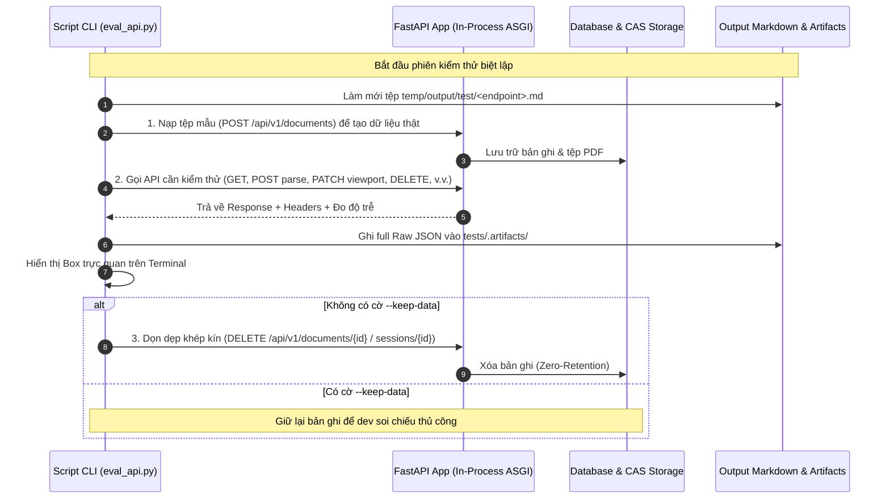

# 🧪 VeriScholar Evaluation Harness & Script Guide

Tài liệu hướng dẫn sử dụng và vận hành bộ công cụ kiểm thử tự động (**Evaluation Harness / Autotest**) cho các API thuộc **Module 1 (Document Ingestion & Management)** và **Quản Lý Phiên Nghiên Cứu (Research Sessions & Dual-Pane Workspace)** theo đúng tiêu chuẩn thiết kế [`docs/vi/design-api-eval-snapshots.md`](file:///home/dammanhdungvn/Downloads/Workspace/VeriScholar/docs/vi/design-api-eval-snapshots.md).

---

## 📌 1. Danh Mục Các API Đã Hoàn Thiện Runner

Bộ kiểm thử hỗ trợ chạy độc lập từng API hoặc chạy toàn bộ theo quy trình chuẩn hóa:

### 1.1. Vòng Đời Bóc Tách & Quản Lý Tài Liệu (Document Lifecycle API)

| STT | API Endpoint (Canonical) | Alias Ngắn | Lệnh Chạy Toàn Bộ Dataset | Lệnh Chạy Đơn Lẻ 1 Bài Báo |
| :---: | :--- | :---: | :--- | :--- |
| **1** | `POST /api/v1/documents` | `upload` | `uv run python scripts/eval_api.py --api upload --bless` | `uv run python scripts/eval_api.py --api upload --paper "Attention Is All You Need.pdf" --bless` |
| **2** | `GET /api/v1/documents` | `list` | `uv run python scripts/eval_api.py --api list --bless` | `uv run python scripts/eval_api.py --api list --paper "Attention Is All You Need.pdf" --bless` |
| **3** | `GET /api/v1/documents/{id}` | `detail` | `uv run python scripts/eval_api.py --api detail --bless` | `uv run python scripts/eval_api.py --api detail --paper "Attention Is All You Need.pdf" --bless` |
| **4** | `GET /api/v1/documents/{id}/file` | `stream` | `uv run python scripts/eval_api.py --api stream --bless` | `uv run python scripts/eval_api.py --api stream --paper "Attention Is All You Need.pdf" --bless` |
| **5** | `GET /api/v1/documents/{id}/status`| `status` | `uv run python scripts/eval_api.py --api status --bless` | `uv run python scripts/eval_api.py --api status --paper "Attention Is All You Need.pdf" --bless` |
| **6** | `POST /api/v1/documents/{id}:star` | `star` | `uv run python scripts/eval_api.py --api star --bless` | `uv run python scripts/eval_api.py --api star --paper "Attention Is All You Need.pdf" --bless` |
| **7** | `POST /api/v1/documents/{id}:parse`| `parse` | `uv run python scripts/eval_api.py --api parse --bless` | `uv run python scripts/eval_api.py --api parse --paper "Attention Is All You Need.pdf" --bless` |
| **8** | `POST /api/v1/documents/{id}:extract-references` | `extract-refs` | `uv run python scripts/eval_api.py --api extract-refs --bless` | `uv run python scripts/eval_api.py --api extract-refs --paper "Attention Is All You Need.pdf" --bless` |
| **9** | `GET /api/v1/documents/{id}/structure` | `structure` | `uv run python scripts/eval_api.py --api structure --bless` | `uv run python scripts/eval_api.py --api structure --paper "Attention Is All You Need.pdf" --bless` |
| **10** | `GET /api/v1/documents/{id}/chunks` | `chunks` | `uv run python scripts/eval_api.py --api chunks --bless` | `uv run python scripts/eval_api.py --api chunks --paper "Attention Is All You Need.pdf" --bless` |
| **11** | `GET /api/v1/documents/{id}/chunks/{chunk_id}` | `chunk_detail` | `uv run python scripts/eval_api.py --api chunk_detail --bless` | `uv run python scripts/eval_api.py --api chunk_detail --paper "Attention Is All You Need.pdf" --bless` |
| **12** | `GET /api/v1/documents/{id}/summary` | `summary` | `uv run python scripts/eval_api.py --api summary --bless` | `uv run python scripts/eval_api.py --api summary --paper "Attention Is All You Need.pdf" --bless` |
| **13** | `POST /api/v1/documents/{id}/summary:generate` | `summary-generate` | `uv run python scripts/eval_api.py --api summary-generate --bless` | `uv run python scripts/eval_api.py --api summary-generate --paper "Attention Is All You Need.pdf" --bless` |
| **14** | `POST /api/v1/documents/{id}/summary:stream` | `summary-stream` | `uv run python scripts/eval_api.py --api summary-stream --bless` | `uv run python scripts/eval_api.py --api summary-stream --paper "Attention Is All You Need.pdf" --bless` |
| **15** | `GET /api/v1/documents/{id}/export-pdf` | `export-pdf` | `uv run python scripts/eval_api.py --api export-pdf --bless` | `uv run python scripts/eval_api.py --api export-pdf --paper "Attention Is All You Need.pdf" --bless` |
| **16** | `DELETE /api/v1/documents/{id}` | `delete` | `uv run python scripts/eval_api.py --api delete --bless` | `uv run python scripts/eval_api.py --api delete --paper "Attention Is All You Need.pdf" --bless` |

### 1.2. Sổ Tay Nghiên Cứu & AI Đúc Kết (Smart Notebook #16 - #21)

| STT | API Endpoint (Canonical) | Alias Ngắn | Lệnh Chạy Đánh Giá Kịch Bản |
| :---: | :--- | :---: | :--- |
| **17** | `MULTI /api/v1/notes/*` (#16 - #21) | `notes` | `uv run python scripts/eval_api.py --api notes --bless` |

### 1.3. Quản Lý Phiên Nghiên Cứu & Dual-Pane Workspace (Session API #45 - #55)

| STT | API Endpoint (Canonical) | Alias Ngắn | Lệnh Chạy Đánh Giá Kịch Bản |
| :---: | :--- | :---: | :--- |
| **18** | `POST /api/v1/sessions` (#45 Khởi tạo phiên) | `create-session` | `uv run python scripts/eval_api.py --api create-session --bless` |
| **19** | `GET /api/v1/sessions` (#46 Sidebar History) | `list-sessions` | `uv run python scripts/eval_api.py --api list-sessions --bless` |
| **20** | `GET /api/v1/sessions/{id}` (#47 Khôi phục phiên) | `session-detail` | `uv run python scripts/eval_api.py --api session-detail --bless` |
| **21** | `PATCH /api/v1/sessions/{id}/viewport` (#49 Lưu Viewport & OCC) | `viewport` | `uv run python scripts/eval_api.py --api viewport --bless` |
| **22** | `DELETE /api/v1/sessions/{id}` (#50 Xóa phiên) | `delete-session` | `uv run python scripts/eval_api.py --api delete-session --bless` |
| **23** | `POST /api/v1/sessions/{id}/documents` (#51 Nạp bài vào phiên) | `post_session_documents` | `uv run python scripts/eval_api.py --api post_session_documents --bless` |
| **24** | `POST /api/v1/sessions/{id}/messages` (#52 Gửi câu hỏi & Stream SSE) | `post_session_messages` / `chat` | `uv run python scripts/eval_api.py --api post_session_messages --bless` |
| **25** | `MULTI /api/v1/sessions/*` (#48, #52 - #55 Lifecycle Suite) | `lifecycle` | `uv run python scripts/eval_api.py --api lifecycle --bless` |

---

## ⚡ 2. Cách Chạy Script Đánh Giá

### 2.1. Chạy Từng API Đơn Lẻ (Single Runner)
Sử dụng cờ `--api <tên_endpoint_hoặc_alias>`:

```bash
# === Nhóm Tài Liệu (Document Lifecycle) ===
# Đánh giá API Upload tài liệu
uv run python scripts/eval_api.py --api upload --bless

# Đánh giá API Lấy chi tiết tài liệu với 1 bài báo chỉ định
uv run python scripts/eval_api.py --api detail --paper "Attention Is All You Need.pdf" --bless

# Đánh giá API Bóc tách danh mục tham khảo
uv run python scripts/eval_api.py --api extract-refs --paper "Attention Is All You Need.pdf" --bless

# Đánh giá API Bóc tách cấu trúc bài báo (TOC, Abstract, Sections)
uv run python scripts/eval_api.py --api structure --paper "Attention Is All You Need.pdf" --bless

# Đánh giá API Danh sách Chunks (phân trang + bounding boxes)
uv run python scripts/eval_api.py --api chunks --paper "Attention Is All You Need.pdf" --bless

# Đánh giá API Chi tiết 1 đoạn bằng chứng (Chunk Detail + Nav Links)
uv run python scripts/eval_api.py --api chunk_detail --paper "Attention Is All You Need.pdf" --bless

# Đánh giá API Sinh mới tóm tắt 3 ý (Custom Method AIP-136)
uv run python scripts/eval_api.py --api summary-generate --paper "Attention Is All You Need.pdf" --bless

# Đánh giá API Stream SSE Tóm tắt thời gian thực
uv run python scripts/eval_api.py --api summary-stream --paper "Attention Is All You Need.pdf" --bless

# Đánh giá API Xuất bản PDF có Native Annotations
uv run python scripts/eval_api.py --api export-pdf --paper "Attention Is All You Need.pdf" --bless

# === Nhóm Sổ Tay (Smart Notebook) ===
# Đánh giá API Sổ tay & AI Đúc kết (#16 - #21)
uv run python scripts/eval_api.py --api notes --bless

# === Nhóm Phiên Nghiên Cứu (Research Sessions) ===
# Đánh giá API Khởi tạo phiên làm việc (#45)
uv run python scripts/eval_api.py --api create-session --bless

# Đánh giá API Lấy danh sách lịch sử phiên Sidebar (#46)
uv run python scripts/eval_api.py --api list-sessions --bless

# Đánh giá API Khôi phục toàn vẹn phiên làm việc (#47)
uv run python scripts/eval_api.py --api session-detail --bless

# Đánh giá API Lưu vị trí cuộn trang PDF và Tab đang mở với OCC (#49)
uv run python scripts/eval_api.py --api viewport --bless

# Đánh giá API Xóa phiên làm việc & Zero Retention (#50)
uv run python scripts/eval_api.py --api delete-session --bless

# Đánh giá API Nạp bài vào phiên làm việc (Pure JSON: url hoặc document_id) (#51)
uv run python scripts/eval_api.py --api post_session_documents --bless

# Đánh giá API Gửi câu hỏi & Stream SSE đa bài báo (#52)
uv run python scripts/eval_api.py --api post_session_messages --bless

# Đánh giá Bộ vòng đời phiên đa tài liệu (#48, #51 - #55)
uv run python scripts/eval_api.py --api lifecycle --bless
```

### 2.2. Chạy Toàn Bộ Suite Module 1 (All Endpoints)
Chạy tuần tự toàn bộ danh mục API theo đúng thứ tự vòng đời nghiệp vụ:

```bash
uv run python scripts/eval_api.py --all --bless
```

---

## 🛠️ 3. Các Tùy Chọn Dòng Lệnh Nâng Cao (CLI Flags)

- `--paper <tên_file.pdf>`: Chỉ định chính xác 1 bài báo khoa học trong thư mục `data/papers/` để chạy kiểm thử cục bộ nhanh chóng (ví dụ: `--paper "Attention Is All You Need.pdf"`).
- `--bless`: Tự động cập nhật snapshot đối chiếu khi bạn chủ động thay đổi logic hoặc chuẩn hóa định dạng dữ liệu đầu ra.
- `-k`, `--keep-data`: Giữ lại tài liệu trong cơ sở dữ liệu sau khi chạy xong để kiểm tra thủ công (mặc định runner sẽ tự động xóa sạch để bảo đảm tính khép kín Zero-Retention).
- `--interactive`: Bật chế độ tương tác hỏi trước khi ghi đè tệp báo cáo cũ (mặc định runner chạy tự động không chặn dòng lệnh).

---

## 🔄 4. Cơ Chế Vận Hành & Khép Kín Dữ Liệu (Hermetic Cycle)

Mỗi lần chạy script kiểm thử, hệ thống thực hiện chu trình khép kín nhằm bảo đảm tính độc lập, không làm rác môi trường phát triển:



---

## 📂 5. Vị Trí Lưu Kết Quả & Snapshots

- **Báo cáo định dạng Markdown (Dành cho người đọc):**
  - Nằm tại thư mục: `temp/output/test/`
  - Ví dụ:
    * Tài liệu: `post_documents_upload.md`, `get_documents_list.md`, `get_documents_detail.md`, `get_documents_file_stream.md`, `get_documents_status.md`, `post_documents_star.md`, `post_documents_parse.md`, `post_documents_extract_references.md`, `get_documents_structure.md`, `get_documents_chunks.md`, `get_documents_chunk_detail.md`, `get_documents_summary.md`, `post_documents_summary_generate.md`, `post_document_summary_stream.md`, `get_documents_export_pdf.md`, `delete_documents.md`.
    * Sổ tay: `notes_and_synthesis.md`.
    * Phiên làm việc: `post_sessions_create.md`, `get_sessions_list.md`, `get_session_detail.md`, `patch_session_viewport.md`, `delete_session.md`, `post_session_documents.md`, `post_sessions_chat.md`, `sessions_lifecycle.md`.
- **Dữ liệu thô gốc (Raw JSON Artifacts & Checksums):**
  - Nằm tại thư mục: `tests/.artifacts/<tên_endpoint>/`
  - Chứa 100% dữ liệu gốc không bị cắt xén (untruncated JSON payload) phục vụ kiểm chứng tính toàn vẹn (SHA-256).

---

## 🔍 6. Soi Chi Tiết Lỗi & Payload (`surgical_inspect.py`)

Khi cần đào sâu kiểm tra dữ liệu JSON gốc hoặc tìm xem hệ thống có sinh lỗi gì không:

```bash
# Xem danh sách toàn bộ file kết quả và artifact hiện có:
uv run python scripts/eval_api.py --summary

# Soi chi tiết toàn bộ dữ liệu của một bài báo:
uv run python scripts/eval/surgical_inspect.py -a "Attention Is All You Need_initial"

# Tìm kiếm nhanh chuỗi lỗi hoặc keyword trong toàn bộ artifacts:
uv run python scripts/eval/surgical_inspect.py -q "error"
```

---

## 🧹 7. Dọn Dẹp Sạch Dữ Liệu Database (`purge_all.py`)

Khi bạn từng chạy với cờ `-k` / `--keep-data` hoặc muốn đưa môi trường kiểm thử về trạng thái sạch sẽ hoàn toàn (0 bản ghi):

```bash
uv run python scripts/eval/purge_all.py
```
> **Cơ chế an toàn:** Script sẽ gọi endpoint chính thức `DELETE /api/v1/documents/{document_id}` để kích hoạt dọn dẹp phân tầng (cascading zero-retention), giải phóng cả bản ghi trong PostgreSQL lẫn tệp PDF vật lý trong CAS Storage.
