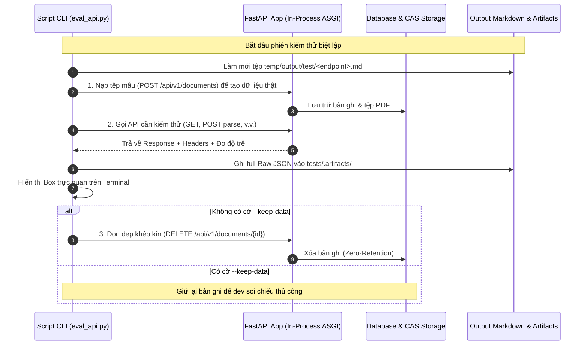

# 🛠️ Hướng Dẫn Vận Hành Scripts Kiểm Thử Tự Động (Evaluation Harness)

Thư mục `scripts/` chứa toàn bộ công cụ dòng lệnh (CLI) phục vụ việc chạy kiểm thử tự động (**Autotest Snapshots**), đo lường độ trễ, kiểm chứng chất lượng nghiệp vụ (CAS Deduplication, Phân trang RFC 8288, Trích xuất tham khảo, Bounding Box IoU) và soi chiếu dữ liệu chi tiết của hệ thống **VeriScholar**.

---

## 📌 1. Bảng Tra Cứu Lệnh Chạy Từng API (API Evaluation Reference Table)

Hệ thống hỗ trợ 2 chế độ chạy cho mỗi API:
- **Chạy Trọn Vẹn (Full Dataset - Mặc Định):** Duyệt qua toàn bộ danh mục tài liệu mẫu có trong `data/papers/` và các kịch bản biên.
- **Chạy Lẻ (Single Target):** Thêm cờ `--paper "<tên_bài_báo.pdf>"` khi bạn muốn tập trung debug nhanh một bài báo cụ thể.

| STT | Phương Thức & Route | Alias CLI | Lệnh Chạy Toàn Bộ (Full Dataset) | Lệnh Chạy Lẻ 1 Bài Báo (Single Paper) |
| :---: | :--- | :---: | :--- | :--- |
| **1** | `POST /api/v1/documents` | `upload` | `uv run python scripts/eval_api.py --api upload --bless` | `uv run python scripts/eval_api.py --api upload --paper "Attention Is All You Need.pdf" --bless` |
| **2** | `GET /api/v1/documents` | `list` | `uv run python scripts/eval_api.py --api list --bless` | *(API danh sách không áp dụng lọc lẻ theo bài báo)* |
| **3** | `GET /api/v1/documents/{id}` | `detail` | `uv run python scripts/eval_api.py --api detail --bless` | `uv run python scripts/eval_api.py --api detail --paper "Attention Is All You Need.pdf" --bless` |
| **4** | `GET /api/v1/documents/{id}/file` | `stream` | `uv run python scripts/eval_api.py --api stream --bless` | `uv run python scripts/eval_api.py --api stream --paper "Attention Is All You Need.pdf" --bless` |
| **5** | `GET /api/v1/documents/{id}/status` | `status` | `uv run python scripts/eval_api.py --api status --bless` | `uv run python scripts/eval_api.py --api status --paper "Attention Is All You Need.pdf" --bless` |
| **6** | `POST /api/v1/documents/{id}:star` | `star` | `uv run python scripts/eval_api.py --api star --bless` | `uv run python scripts/eval_api.py --api star --paper "Attention Is All You Need.pdf" --bless` |
| **7** | `POST /api/v1/documents/{id}:parse` | `parse` | `uv run python scripts/eval_api.py --api parse --bless` | `uv run python scripts/eval_api.py --api parse --paper "Attention Is All You Need.pdf" --bless` |
| **8** | `POST /api/v1/documents/{id}:extract-references` | `extract-refs` | `uv run python scripts/eval_api.py --api extract-refs --bless` | `uv run python scripts/eval_api.py --api extract-refs --paper "Attention Is All You Need.pdf" --bless` |
| **9** | `DELETE /api/v1/documents/{id}` | `delete` | `uv run python scripts/eval_api.py --api delete --bless` | `uv run python scripts/eval_api.py --api delete --paper "Attention Is All You Need.pdf" --bless` |

---

## ⚡ 2. Lệnh Chạy Toàn Bộ 9 APIs (Full Pipeline Regression)

Khi muốn kiểm thử toàn diện toàn bộ 9 APIs của Module 1 để đảm bảo không bị hồi quy (regression):

```bash
uv run python scripts/eval_api.py --all --bless
```

---

## ⚙️ 3. Giải Thích Các Cờ Lệnh CLI Phổ Biến

| Cờ Lệnh (Flag) | Ý Nghĩa Kỹ Thuật | Khi Nào Cần Dùng? |
| :--- | :--- | :--- |
| `--bless` | **Chạy Không Hỏi**: Bỏ qua hộp thoại xác nhận ghi đè tệp báo cáo cũ, tự động xóa sạch và tạo snapshot mới. | Dùng trong CI/CD hoặc khi bạn muốn chạy nhanh không cần gõ `y`. |
| `--paper "<file.pdf>"` | **Chỉ Định Bài Báo**: Chỉ chạy kiểm thử trên đúng bài báo được chỉ định trong `data/papers/`. | Dùng khi đang phát triển (develop) hoặc debug chuyên sâu 1 bài báo. |
| `-k`, `--keep-data` | **Bảo Tồn Dữ Liệu (Không Xóa)**: Ngăn runner gọi `DELETE /api/v1/documents/{id}` ở bước dọn dẹp cuối cùng. | Dùng khi bạn muốn giữ lại dữ liệu trong Database để soi chiếu thủ công. |
| `--ci` | **Bật Cổng CI (Quality Gate)**: Dừng chương trình với mã thoát khác 0 (`exit code 1`) ngay khi có kịch bản thất bại. | Dùng trong kịch bản GitHub Actions hoặc Pre-merge hook. |
| `--url "<http://...>"` | **Chạy Với Live Server**: Chạy kiểm thử qua mạng HTTP thật thay vì chạy trực tiếp trong tiến trình (In-Process ASGI). | Dùng khi server FastAPI đang chạy tách biệt trên Docker hoặc VPS. |

---

## 🔄 4. Cơ Chế Hoạt Động Của Một Vòng Kiểm Thử (Hermetic Testing)

Mỗi lần chạy script kiểm thử, hệ thống thực hiện chu trình khép kín nhằm bảo đảm tính độc lập, không làm rác môi trường phát triển:



---

## 📂 5. Vị Trí Lưu Kết Quả & Snapshots

- **Báo cáo định dạng Markdown (Dành cho người đọc):**
  - Nằm tại thư mục: `temp/output/test/`
  - Ví dụ: `temp/output/test/get_documents_detail.md`, `temp/output/test/post_documents_upload.md`, `temp/output/test/get_documents_file_stream.md`
- **Dữ liệu thô gốc (Raw JSON Artifacts & Checksums):**
  - Nằm tại thư mục: `tests/.artifacts/<tên_endpoint>/`
  - Chứa 100% dữ liệu gốc không bị cắt xén (untruncated JSON payload) phục vụ kiểm chứng tính toàn vẹn (SHA-256).

---

## 🔍 6. Soi Chi Tiết Lỗi & Payload (`surgical_inspect.py`)

Khi cần đào sâu kiểm tra dữ liệu JSON gốc hoặc tìm xem hệ thống có sinh lỗi gì không:

```bash
# Xem danh sách toàn bộ file kết quả và artifact hiện có:
uv run python scripts/eval/surgical_inspect.py --summary

# Soi chi tiết toàn bộ dữ liệu của một bài báo:
uv run python scripts/eval/surgical_inspect.py -a "Attention Is All You Need_initial"

# Chỉ lọc ra các trường hợp bị lỗi hoặc bất thường:
uv run python scripts/eval/surgical_inspect.py -a "Attention Is All You Need_initial" --errors-only
```

---

## 🧹 7. Dọn Dẹp Sạch Dữ Liệu Database (`purge_all.py`)

Khi bạn từng chạy với cờ `-k` / `--keep-data` hoặc muốn đưa môi trường kiểm thử về trạng thái sạch sẽ hoàn toàn (0 bản ghi):

```bash
uv run python scripts/eval/purge_all.py
```
> **Cơ chế an toàn:** Script sẽ gọi endpoint chính thức `DELETE /api/v1/documents/{document_id}` để kích hoạt dọn dẹp phân tầng (cascading zero-retention), giải phóng cả bản ghi trong PostgreSQL lẫn tệp PDF vật lý trong CAS Storage.
