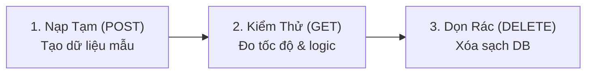

# 🛠️ Hướng Dẫn Vận Hành Scripts Kiểm Thử Tự Động (Evaluation Harness)

Thư mục `scripts/` chứa bộ công cụ dòng lệnh (CLI) giúp kiểm thử tự động toàn diện, đo tốc độ phản hồi (latency), và kiểm chứng tính đúng đắn cho **9 API thuộc Module 1** của VeriScholar.

---

## 🚀 1. Bắt Đầu Nhanh (Quick Start)

Nếu bạn là thành viên mới (Intern/Fresher), hãy bắt đầu bằng 2 lệnh cơ bản sau:

```bash
# 1. Chạy thử kiểm tra 1 API cụ thể (ví dụ: API tải tài liệu lên)
uv run python scripts/eval_api.py --api upload --paper "Attention Is All You Need.pdf" --bless

# 2. Chạy toàn bộ chuỗi 9 API của Module 1 (từ Upload -> Parse -> Chunk -> Xóa)
uv run python scripts/eval_api.py --all --bless
```

---

## 🧠 2. Cơ Chế Hoạt Động (Dành Cho Người Mới Cần Nắm)

Khi bạn chạy các API dạng đọc dữ liệu (như `GET /api/v1/documents` hoặc `GET /api/v1/documents/{id}`), bạn sẽ thấy trên màn hình có lệnh `POST` ở đầu và `DELETE` ở cuối. Đừng bất ngờ, đây là **Quy Trình Tự Động Khép Kín (Hermetic Lifecycle)**:



1. **Bước 1 (Nạp tạm - Seed):** Script tự động `POST` tải file PDF mẫu lên để sinh ra `document_id` thật trên cơ sở dữ liệu.
2. **Bước 2 (Kiểm thử chính):** Gọi `GET` để kiểm tra thông tin tài liệu, phân trang, tọa độ trang PDF.
3. **Bước 3 (Dọn rác - Teardown):** Tự động gọi `DELETE` xóa tài liệu vừa tạo, giữ cơ sở dữ liệu luôn sạch sẽ.

> [!TIP]
> **Mẹo khi test bằng Swagger UI:** Nếu bạn muốn giữ lại dữ liệu trên cơ sở dữ liệu để mở Swagger UI (`http://localhost:8000/docs`) bấm thử bằng tay, hãy thêm cờ **`-k`** (hoặc `--keep-data`). Khi có cờ này, script sẽ **không xóa** dữ liệu sau khi chạy.
>
> Ví dụ: `uv run python scripts/eval_api.py --api detail -k`

---

## 📋 3. Bảng Tra Cứu Lệnh Cho 9 API Module 1

Mỗi API hỗ trợ 2 cách chạy:
- **Chạy lẻ (Single Target):** Thêm `--paper "<tên_file.pdf>"` để debug nhanh 1 bài báo cụ thể trong thư mục `data/papers/`.
- **Chạy trọn vẹn (Full Dataset):** Bỏ cờ `--paper`, script sẽ tự động quét và kiểm thử toàn bộ file PDF trong hệ thống.

| STT | API Endpoint | Tên Rút Gọn (`--api`) | Lệnh Chạy Lẻ 1 Bài Báo (Debug Nhanh) | Lệnh Chạy Trọn Vẹn (Full Dataset) | Script Kiểm Thử Những Gì? |
| :---: | :--- | :---: | :--- | :--- | :--- |
| **1** | `POST /api/v1/documents` | `upload` | `uv run python scripts/eval_api.py --api upload --paper "Attention Is All You Need.pdf" --bless` | `uv run python scripts/eval_api.py --api upload --bless` | Upload PDF, băm SHA-256 CAS, kiểm tra chống tải trùng lặp (Deduplication ~13ms), chặn file hỏng. |
| **2** | `GET /api/v1/documents` | `list` | `uv run python scripts/eval_api.py --api list --bless` *(Tự seed 3 file mẫu)* | `uv run python scripts/eval_api.py --api list --bless` | Phân trang RFC 8288 (`page=1&per_page=2`), liên kết `next`/`prev`, sắp xếp mới nhất trước (`DESC`), chặn trang 0 (`422`). |
| **3** | `GET /api/v1/documents/{id}` | `detail` | `uv run python scripts/eval_api.py --api detail --paper "Attention Is All You Need.pdf" --bless` | `uv run python scripts/eval_api.py --api detail --bless` | Lấy chi tiết bài báo, kích thước trang cho Canvas (`pages_metadata`), chặn UUID không tồn tại (`404`), ID sai định dạng (`422`). |
| **4** | `GET /api/v1/documents/{id}/file` | `stream` | `uv run python scripts/eval_api.py --api stream --paper "Attention Is All You Need.pdf" --bless` | `uv run python scripts/eval_api.py --api stream --bless` | Stream tải file PDF, kiểm tra tải từng đoạn `Range: bytes=0-1023` (HTTP 206) cho trình đọc PDF trên web. |
| **5** | `GET /api/v1/documents/{id}/status` | `status` | `uv run python scripts/eval_api.py --api status --paper "Attention Is All You Need.pdf" --bless` | `uv run python scripts/eval_api.py --api status --bless` | Kiểm tra tiến độ xử lý nền của AI (giai đoạn `stage`, phần trăm `progress: 0..100`). |
| **6** | `POST /api/v1/documents/{id}:star` | `star` | `uv run python scripts/eval_api.py --api star --paper "Attention Is All You Need.pdf" --bless` | `uv run python scripts/eval_api.py --api star --bless` | Đánh dấu sao / ghim tài liệu (`is_persistent: true/false`), kiểm tra tính năng lưu trữ vĩnh viễn. |
| **7** | `POST /api/v1/documents/{id}:parse` | `parse` | `uv run python scripts/eval_api.py --api parse --paper "Attention Is All You Need.pdf" --bless` | `uv run python scripts/eval_api.py --api parse --bless` | Bóc tách nội dung PDF (Semantic Chunking), tọa độ hộp khung Bounding Box hiển thị trên Canvas. |
| **8** | `POST /api/v1/documents/{id}:extract-references` | `extract-references` | `uv run python scripts/eval_api.py --api extract-references --paper "Attention Is All You Need.pdf" --bless` | `uv run python scripts/eval_api.py --api extract-references --bless` | Bóc tách danh mục tài liệu tham khảo, đối chiếu số lượng và mã DOI/arXiv với dữ liệu chuẩn. |
| **9** | `DELETE /api/v1/documents/{id}` | `delete` | `uv run python scripts/eval_api.py --api delete --paper "Attention Is All You Need.pdf" --bless` | `uv run python scripts/eval_api.py --api delete --bless` | Xóa tài liệu khỏi hệ thống (`HTTP 204 No Content`), kiểm tra truy vấn lại ngay sau đó trả về `404 Not Found`. |

---

## 🎛️ 4. Bảng Ý Nghĩa Các Cờ Lệnh (CLI Flags)

| Cờ Lệnh | Viết Tắt | Ý Nghĩa Thực Tế | Khi Nào Nên Dùng? |
| :--- | :---: | :--- | :--- |
| `--api <tên>` | `-a` | Chọn đúng 1 API để chạy kiểm thử. | Khi bạn đang phát triển hoặc sửa lỗi cho 1 API riêng lẻ. |
| `--paper "<file>"` | `-p` | Chỉ chạy trên đúng 1 bài báo chỉ định. | Khi muốn chạy thật nhanh để debug 1 trường hợp cụ thể. |
| `--bless` | `-b` | Tự động làm mới và cập nhật bản snapshot đánh giá. | Luôn nên kèm theo khi chạy để sinh file báo cáo mới nhất. |
| `--keep-data` | `-k` | **Giữ lại dữ liệu trên Database (không xóa).** | Khi bạn muốn mở Swagger UI hoặc Database xem dữ liệu vừa nạp. |
| `--confirm-overwrite` | `-i` | Hỏi xác nhận `(y/n)` trước khi ghi đè tệp báo cáo cũ. | Dùng khi bạn sợ vô tình xóa nhầm báo cáo quan trọng. |
| `--live-cloud` | | Cho phép gọi AI Cloud thật (Azure Document Intelligence). | Dùng khi muốn kiểm thử trực tiếp trên cloud thay vì dùng dữ liệu giả lập (VCR). |

---

## 📊 5. Đọc Kết Quả Kiểm Thử Ở Đâu?

Sau khi lệnh chạy xong, bạn có 2 nơi để xem kết quả:

1. **Xem nhanh ngay trên Terminal (3 Hộp Đóng Khung):**
   - `[REQUEST INPUT]`: Hiển thị URL, Method và Header gửi đi.
   - `[RESPONSE OUTPUT]`: Hiển thị mã HTTP (200, 404,...), tốc độ xử lý (ms) và dữ liệu trả về (được tự động thu gọn thông minh để không làm đơ terminal).
   - `[KIỂM CHỨNG CHẤT LƯỢNG NGHIỆP VỤ]`: Danh sách các dấu tích xanh `✓` xác nhận các yêu cầu nghiệp vụ đã đạt chuẩn.

2. **Xem báo cáo đầy đủ 100% Raw JSON:**  
   Toàn bộ phản hồi gốc không bị cắt bớt được tự động ghi vào thư mục:  
   👉 `temp/output/test/<tên_api>.md`  
   *(Ví dụ: [`temp/output/test/get_documents_detail.md`](file:///home/dammanhdungvn/Downloads/Workspace/VeriScholar/temp/output/test/get_documents_detail.md))*

---

## 🔍 6. Soi Chi Tiết Lỗi & Payload (`surgical_inspect.py`)

Khi cần đào sâu kiểm tra dữ liệu JSON gốc hoặc tìm xem hệ thống có sinh lỗi gì không:

```bash
# Xem danh sách toàn bộ file kết quả và artifact hiện có:
uv run python scripts/eval/surgical_inspect.py --summary

# Soi chi tiết toàn bộ dữ liệu của một bài báo:
uv run python scripts/eval/surgical_inspect.py -a "Attention Is All You Need_initial"

# Chỉ lọc ra các trường hợp bị lỗi hoặc bất thường:
uv run python scripts/eval/surgical_inspect.py -a "Attention Is All You Need_initial" --errors-only
```
